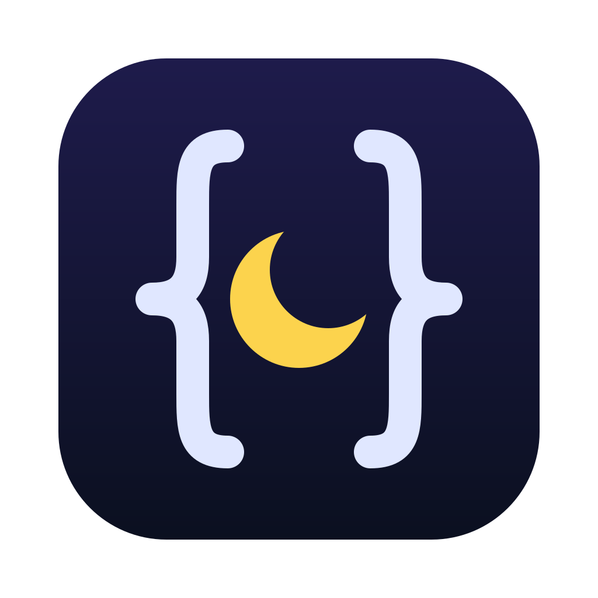
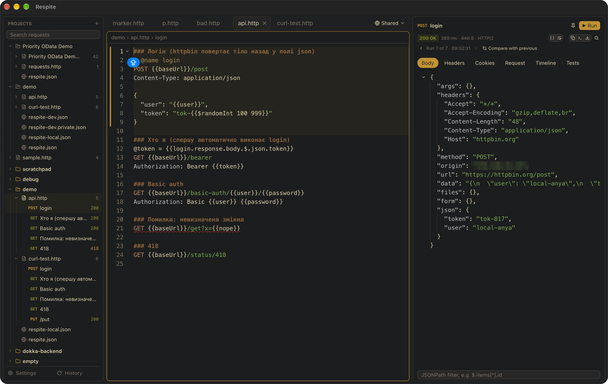

<div align="center">



# Respite

**A fast, text-first REST client. Requests are plain `.http` files.**

Write a request, press <kbd>⌘</kbd> <kbd>Enter</kbd>, read the response. No forms, no cloud, no lock-in.

[](https://www.rust-lang.org)
[](https://www.gpui.rs)
[](#install)
[](Cargo.toml)



</div>

---

## Why Respite

- 📄 **Files are the source of truth.** One `.http` file holds many requests separated by `###`. You can commit it, diff it and review it like any other code.
- 🔁 **Compatible.** Uses the same syntax as VS Code REST Client and JetBrains HTTP Client, so your existing `.http` / `.rest` files open unchanged.
- ⚡ **Native and GPU-rendered.** Built in Rust on [GPUI](https://www.gpui.rs), the UI framework behind Zed.
- 🧰 **GUI and CLI.** The same files run from the desktop app, a terminal or CI, and the CLI can print JSON for scripts and AI agents.
- 📥 **Bring your collections.** Import from Postman, Insomnia, OpenAPI / Swagger, Bruno, HAR and cURL.

## Features

| | |
|---|---|
| **Editor** | `.http` syntax highlighting (JSON, XML, GraphQL and JS bodies), completion, diagnostics with quick fixes, rename, live templates, folding; a syntax reference with runnable examples (<kbd>F1</kbd>) |
| **Response** | Body, headers, cookies, the request as sent, timeline (redirects, time to first byte, download); multi-MB bodies, images, JSONPath filter, run history ‹ › with diff, pin |
| **Variables** | File variables, one file per environment (`respite-dev.json`) with private overrides, dynamic values (`{{$uuid}}`, `{{$timestamp}}`, …), values taken from earlier responses |
| **Requests** | Multipart, form-urlencoded, GraphQL, bodies loaded from files, per-request directives (`@timeout`, `@name`, `@insecure`, …); TLS checks can also be turned off for all requests in Settings |
| **Tests** | `# @assert status == 201`, `# @assert body $.id exists`, `# @assert duration < 500ms`: httpyac's operators, written as comments so the file still runs in VS Code and JetBrains; results in the Tests tab, `respite run` exits 1 on a failure |
| **History** | Every run is stored per project: a sortable, filterable table with status, duration and an OK / failed summary; reopen or rerun any entry |
| **cURL** | Paste a `curl` command and get a request block; copy any request back as cURL |
| **Workspace** | Collections in `~/.config/respite` plus any project folders, light and dark themes, settings, state restored on launch |

## Quick start

```http
@host = https://httpbin.org

### Get my IP
GET {{host}}/ip
Accept: application/json

### Create a user
# @name createUser
POST {{host}}/post
Content-Type: application/json

{
  "name": "Ada",
  "id": "{{$uuid}}"
}
```

Save this as `api.http`, open it in Respite and press <kbd>⌘</kbd> <kbd>Enter</kbd> on either request. To run it from a terminal instead:

```sh
respite run api.http "Get my IP"
```

## Install

Respite currently targets **macOS**. Linux should work but has not been tested yet.

```sh
git clone git@github.com:gandriyko/respite.git
cd respite

# Desktop app → target/release/Respite.app (--install also copies it to /Applications)
scripts/bundle-macos.sh --install

# Or just the binary (GUI + CLI in one)
cargo install --path crates/app
```

You need a recent stable Rust toolchain (edition 2024); see [Development setup](#development-setup-macos) for installing it with Homebrew.

## Desktop app

Run `respite` with no arguments to open your collections in `~/.config/respite`. Run `respite path/to/dir` or `respite file.http` to open a specific project. Each folder in `~/.config/respite` shows up as a collection at the top of the sidebar, and imported collections are saved there too.

| Shortcut | Action |
|---|---|
| <kbd>⌘</kbd> <kbd>Enter</kbd> | Run the request under the cursor |
| <kbd>⌘</kbd> <kbd>V</kbd> | Smart paste: a cURL command becomes a request block |
| <kbd>⌘</kbd> <kbd>⇧</kbd> <kbd>C</kbd> | Copy request as cURL |
| <kbd>⌘</kbd> <kbd>⌥</kbd> <kbd>E</kbd> | Next environment |
| <kbd>⌘</kbd> <kbd>Y</kbd> | History |
| <kbd>⌘</kbd> <kbd>B</kbd> | Toggle sidebar |
| <kbd>⌘</kbd> <kbd>,</kbd> | Settings |
| <kbd>F1</kbd> | Syntax reference |
| <kbd>⌘</kbd> <kbd>S</kbd> / <kbd>⌘</kbd> <kbd>W</kbd> | Save / close tab |

## CLI

The desktop app and the CLI ship as one binary.

```text
respite list         List requests: file, line, name, method, URL
respite show         Print a request block; --resolved substitutes variables
respite run          Run requests (all of them in file order when none are named)
respite check        Diagnostics without sending anything (pre-commit / CI)
respite import       Postman / Insomnia / OpenAPI / Swagger / Bruno / HAR → .http files
respite import-curl  cURL from stdin or the clipboard → request block(s)
respite export-curl  Request → cURL command
respite env          Environments from respite-<env>(.private).json
respite auth         OAuth 2.0 tokens: print one (token ID), forget them (clear)
respite history      Past executions of this workspace
```

Some useful flags:

```sh
respite run api.http --env prod --output json        # machine-readable output
respite run api.http createUser --dry-run            # show the resolved request, send nothing
respite run api.http --fail-on-status --fail-fast    # use it as a smoke test in CI
respite run api.http --jsonpath '$.items[*].id'      # print only the matching values
```

## OAuth 2.0

Write the token into a request as in JetBrains HTTP Client, and the file runs there too:

```http
GET https://api.example.com/me
Authorization: Bearer {{$auth.token("api")}}
```

The config lives in an env file under `Security` → `Auth`, with JetBrains' field names. Commit the config, and keep the secret in the git-ignored private file:

```jsonc
// respite-dev.json
{
  "Security": { "Auth": { "api": {
    "Type": "OAuth2",
    "Grant Type": "Client Credentials",
    "Token URL": "https://auth.example.com/oauth/token",
    "Client ID": "respite",
    "Client Secret": "{{clientSecret}}",
    "Scope": "read write"
  }}}
}

// respite-dev.private.json
{ "clientSecret": "…" }
```

- **Grants.** `Client Credentials` and `Password` work now. `"Type": "Mock"` with a `"Token"` gives a fixed token for tests. Browser flows (Authorization Code with PKCE, Device Authorization) come next.
- **Other fields.** `Client Credentials` (`basic`, `in body` or `none`), `Custom Request Parameters`, `Custom Request Headers` and `Acquire Automatically`. `{{$auth.idToken("api")}}` gives the ID token.
- **When a token is fetched.** Only when a request first needs it. It is reused until shortly before it expires, renewed with the refresh token when there is one, and fetched again when the config changes.
- **Cache.** Tokens are kept per environment in `~/.respite/history/<project>/oauth.<env>.json`, a file only you can read. The app and the CLI share it, and history masks the tokens.
- **Commands.** `respite auth token api --env dev` prints a token, `respite auth clear --env dev` forgets them. In the app, use **Clear OAuth 2.0 Tokens** in the command palette.

To try it, the public Duende demo server accepts client `m2m` with secret `secret` and scope `api` at `https://demo.duendesoftware.com/connect/token`. Its API is `https://demo.duendesoftware.com/api/test`.

## Tests

Write checks above the request line. They are plain comments to VS Code REST Client and JetBrains, so the file still runs there; Respite runs them after every response.

```http
### Create a user
# @name createUser
# @assert status == 200
# @assert header content-type contains json
# @assert body $.json.name == {{name}}
# @assert body json.id exists
# @assert duration < 2 s
POST https://httpbin.org/post
Content-Type: application/json

{"name": "{{name}}", "id": "{{$uuid}}"}
```

`# @assert <subject> <operator> [value]`, with httpyac's vocabulary:

| | |
|---|---|
| **Subjects** | `status` · `header <name>` · `body` (the whole body as text) · `body <JSONPath>` (`$.a[0].b`; a bare `a.b` means `$.a.b`) · `duration` (total ms; the value may use `ms` / `s` / `m`) |
| **Compare** | `==` `!=` `<` `<=` `>` `>=` (numbers as numbers, otherwise text) · `contains` `startsWith` `endsWith` · `matches` (regex) |
| **No value** | `exists` · `isTrue` · `isFalse` · `isNumber` · `isString` · `isBoolean` · `isArray` |

The value may hold `{{variables}}`. In the app, results show in the **Tests** tab, and a red dot marks the tab when one fails. `respite run` prints ✓ / ✗ for each check, lists them under `tests` in JSON output, and exits with `1` when any fails, which makes a `.http` file a CI smoke test:

```sh
respite run api.http --env staging --fail-fast
```

## AI agents

[`skills/respite/SKILL.md`](skills/respite/SKILL.md) teaches a coding agent (Claude Code, Codex and others that read Agent Skills) to send requests and test an API through the CLI. Copy the folder into the agent's skills directory, for example `~/.claude/skills/respite`.

## Environments

One flat file per environment, found in every folder from the workspace root down to the `.http` file (deeper folders win). `respite.json` holds values shared by all environments. Keep secrets in `.private` files and git-ignore them:

```jsonc
// respite-dev.json
{ "host": "http://localhost:8080" }

// respite-prod.json
{ "host": "https://api.example.com" }

// respite-prod.private.json  (git-ignored)
{ "token": "…" }
```

The workspace root, shared by the app and the CLI, is the first of: the deepest project folder added to the sidebar, the nearest folder with `.git` or `.respite`, the collection folder (`~/.config/respite/<name>`), the `.http` file's own folder. History and saved state are kept per root in `~/.respite`.

## Project layout

```text
crates/
  app/          GPUI desktop app (sidebar, editor, response panel, history, settings)
  cli/          respite CLI commands
  http-syntax/  .http parser
  http-env/     environments and variable resolution
  http-exec/    executor on reqwest: cookies, timings, history store
  http-curl/    cURL ⇄ request conversion
  http-import/  Postman, Insomnia, OpenAPI, Bruno and HAR importers
  settings/     ~/.config/respite/settings.json plus per-project overrides
```

## Development setup (macOS)

Everything comes from [Homebrew](https://brew.sh) plus Apple's Command Line Tools; full Xcode is not needed.

```sh
# Compiler, linker and the macOS SDK (iconutil for the app icon is included)
xcode-select --install

# Rust toolchain; cmake builds aws-lc (TLS), librsvg is only for regenerating the icon
brew install rust cmake librsvg

git clone git@github.com:gandriyko/respite.git
cd respite
cargo run -p respite                      # the app, opening ~/.config/respite
cargo run -p respite -- path/to/api.http  # the app on a file or folder
cargo run -p respite -- run api.http      # the CLI
```

Before committing:

```sh
cargo test --workspace
cargo clippy --workspace --all-targets   # expected to be warning-free
```

Other tasks:

```sh
scripts/bundle-macos.sh       # target/release/Respite.app
scripts/make-icon.sh          # crates/app/assets/icon.svg → Respite.icns
```

`scripts/bundle-macos.sh --universal` builds for both Apple Silicon and Intel and needs rustup instead of Homebrew's `rust`:

```sh
brew uninstall rust && brew install rustup
export PATH="$(brew --prefix rustup)/bin:$PATH"   # keg-only; add this line to ~/.zshrc
rustup default stable
rustup target add x86_64-apple-darwin aarch64-apple-darwin
```

## Roadmap

- [x] `.http` parser, variables, environments, executor, history
- [x] CLI with JSON output, cURL import and export
- [x] Import from Postman, Insomnia, OpenAPI / Swagger, Bruno and HAR
- [x] Navigation: <kbd>⌘</kbd> <kbd>P</kbd>, go to request, command palette, breadcrumbs
- [x] Autocompletion and inline diagnostics in the editor
- [ ] Timeline: DNS, TCP and TLS phases
- [ ] MCP server for AI agents
- [x] Declarative assertions (`# @assert`)
- [ ] Pre-request and test scripts, JUnit output
- [x] OAuth 2.0: Client Credentials, Password, refresh tokens (`$auth.token`)
- [ ] OAuth 2.0 browser flows: Authorization Code + PKCE, Device Authorization
- [ ] WebSocket, SSE, gRPC; AWS SigV4 auth

## License

[MIT](Cargo.toml)
